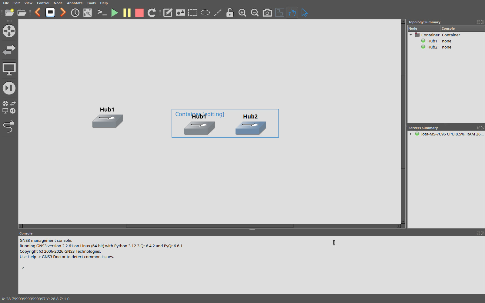
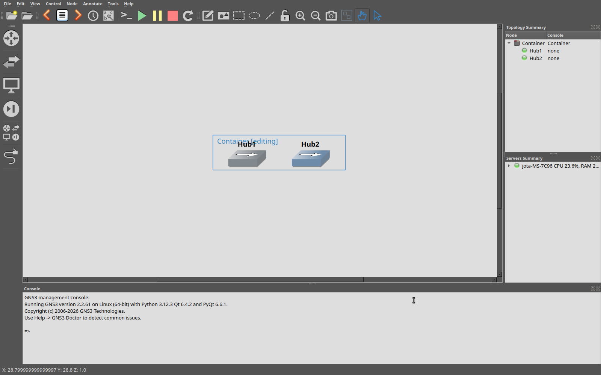
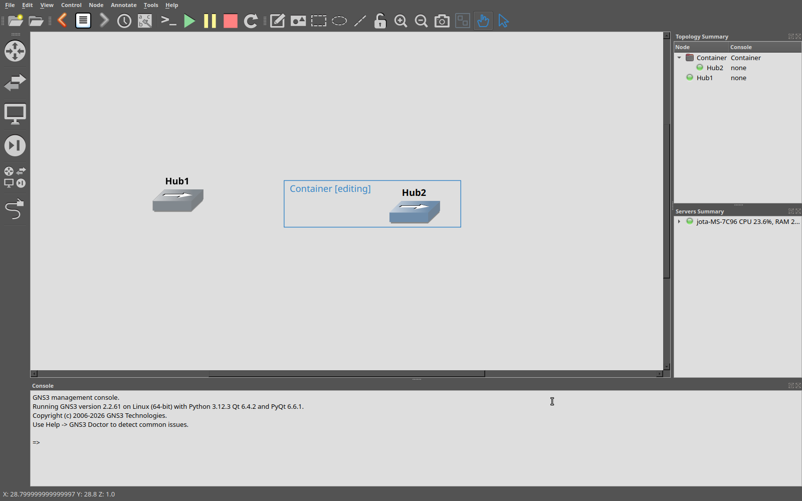

# Clone visual após saída de container e Undo/Redo

## Reprodução e diagnóstico — 20 de outubro de 2026

O vídeo enviado mostra um símbolo preservado na localização anterior ao navegar
pelo histórico de associação a containers. Este defeito é distinto do problema
anterior de propriedade SIP: aquela correção permanece intacta.

A versão base `64590668` foi exercitada com MainWindow, cliente HTTP Qt,
WebSockets e GNS3 Server 2.2.61 reais. PyAutoGUI selecionou dois hubs, criou um
container, entrou em seu modo de edição, arrastou Hub1 para fora e enviou
Ctrl+Z/Ctrl+Y nativos. As screenshots foram capturadas por Pillow ImageGrab na
saída X11 do compositor, sem scene.render ou viewport.grab: essas capturas Qt
podem solicitar pintura e mascarar o defeito.

O primeiro Undo reproduziu o problema: **1.883 pixels coloridos** permaneceram
na posição externa anterior. Existia exatamente **um NodeItem para o UUID**;
seu pai e posição reais estavam corretos. A segunda imagem era conteúdo antigo
da tela, sem criação de outro dispositivo ou entrada extra no histórico.



Ambiente: **Ubuntu 24.04.5**, Python 3.12.3, Qt 6.4.2, PyQt 6.6.1 e servidor
GNS3 2.2.61. A validação Wayland usou o backend nativo Qt Wayland em Weston 13
isolado, aninhado em Xvfb; PyAutoGUI enviou mouse e teclado através do backend
X11 que hospeda o compositor. Uma execução separada validou Qt X11. Não se trata
de uma execução no compositor GNOME da sessão pessoal do usuário.

A interrupção anterior removeu o worktree e as evidências ainda em /tmp. A
correção foi reconstruída e os testes antes/depois foram repetidos nesta retomada;
as capturas relevantes agora integram este repositório.

## Causa e correção

O replay aplica coordenadas confirmadas dos dispositivos e depois restaura
metadados e hierarquia dos containers. Um dispositivo selecionado pode assim
mudar da região externa para a interna e adquirir um pai com clipping antes de
Qt processar os eventos de pintura pendentes. A invalidação baseada no item pode
então ser recortada pelo novo ancestral, omitindo pixels na posição anterior.
O caminho de liberação de arraste já atualiza o viewport; o replay expôs a região
que faltava invalidar.

Os helpers compartilhados `set_scene_position` e `reparent` agora capturam os
limites pintados anteriores e invalidam diretamente as regiões anterior e atual
na cena após mudanças de geometria. Os limites incluem filhos, cobrindo legendas
e objetos aninhados. Retângulos distantes continuam separados, regiões vazias são
ignoradas e geometria inalterada não solicita atualização extra. Qt consolida
as solicitações assíncronas de pintura.

Não há reconstrução da topologia, recriação de dispositivos, requisição adicional
ao servidor, repaint síncrono forçado ou alteração do formato persistido. A
transferência de propriedade para a cena por SIP é preservada, assim como a
conversão de coordenadas, o snap e as coordenadas confirmadas no servidor.




## Testes e prevenção de regressão

- Dois casos Qt, com zoom 1 e 1,41, observam eventos reais de pintura após mover
  um hub selecionado e atribuir um pai com clipping. Exigem repintura nas regiões
  antigas do símbolo e da legenda. Ambos falham no baseline e passam corrigidos.
  Não conectam scene.changed nem usam captura Qt, pois isso pode mudar o caminho
  de atualização que se pretende testar.
- O roteiro nativo agora verifica ausência e presença: seis ciclos Ctrl+Z/Ctrl+Y
  devem deixar menos de dez pixels coloridos na região antiga, mais de trinta na
  região atual e exatamente um item gráfico para o UUID. Antes, verificar somente
  a presença atual permitia que rastros passassem despercebidos.
- Nas doze transições de cada execução corrigida, a região antiga ficou com
  **zero pixels coloridos**, com o símbolo atual presente, em Wayland e X11.
- O roteiro também exercita oito hubs, saídas e inserções sucessivas, coleta de
  lixo, undo/redo, fechamento/reabertura e restauração do cursor persistido.
- Suíte pytest: **537 aprovados, 1 ignorado**, com o aviso preexistente de
  depreciação de tarfile.
- O roteiro separado com servidor real valida operações agrupadas, dispositivos,
  links, redimensionamento e associações de containers, reabertura, exportação e
  importação portátil com replay, imagens grandes e recuperação de histórico.

## Repetir a validação

Executar somente com um servidor descartável; o roteiro modifica e remove apenas
os projetos que ele próprio cria. Requer PyAutoGUI, Pillow, PyQt6 e GNS3 Server.

```sh
QT_QPA_PLATFORM=offscreen python3 -m pytest -q
QT_QPA_PLATFORM=offscreen python3 scripts/check_history.py --server http://127.0.0.1:3099
QT_QPA_PLATFORM=xcb xvfb-run -a -s '-screen 0 1600x1000x24' python3 scripts/check_container_visibility.py --server http://127.0.0.1:3099 --evidence-dir /tmp/container-replay-x11
```

Para Wayland, executar o último roteiro com QT_QPA_PLATFORM=wayland e os valores
WAYLAND_DISPLAY/XDG_RUNTIME_DIR do compositor isolado. DISPLAY e XAUTHORITY devem
endereçar sua superfície X11, utilizada por PyAutoGUI e ImageGrab. As capturas e
state.log ficam em --evidence-dir; o roteiro verifica modelo/servidor e reabertura
além dos pixels. A verificação por cor pressupõe o símbolo hub e o fundo neutro
preparados pelo roteiro; o teste Qt cobre também a região da legenda preta.
