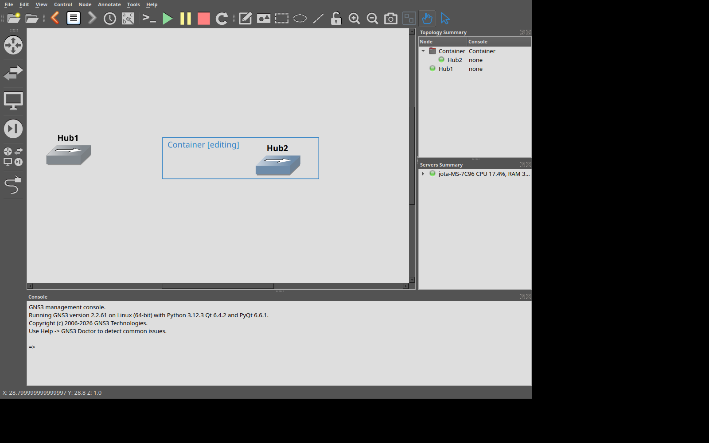
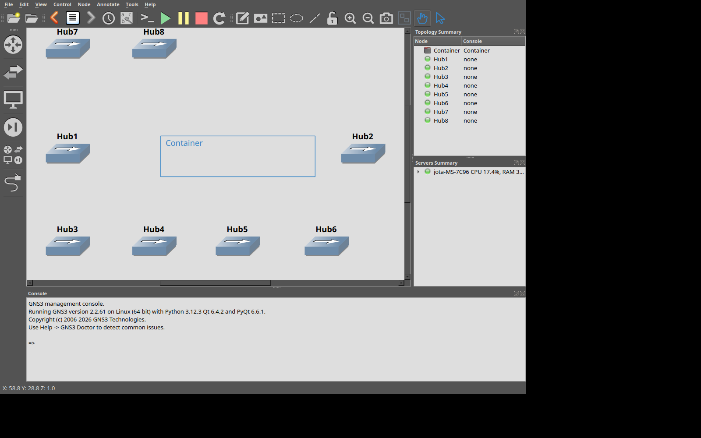

# Desaparecimento de dispositivos após sair de containers

## Resultado da investigação

A causa principal era a propriedade dos **itens gráficos no binding PyQt/SIP**.
Não era a exclusão dos dispositivos do servidor, nem uma ação omitida pelo
histórico. Ao executar `setParentItem(None)`, SIP devolvia a propriedade do item
para Python, embora o objeto C++ continuasse em `QGraphicsScene`.
Quando as últimas referências Python temporárias eram liberadas, o destrutor
removia o item gráfico da cena. O modelo `Node` e o dispositivo no servidor
continuavam existindo; por isso a topologia e o histórico continuavam corretos.

O momento de liberação das referências variava entre eventos de mouse, callbacks,
listas de seleção e percursos da cena. Isso explica por que um dispositivo podia
sumir ao soltar o mouse, enquanto outros sobreviviam até uma operação posterior.
Não era necessário haver um arquivo antigo ou uma falha de persistência.

## Reprodução determinística e motivo dos testes anteriores passarem

No ambiente utilizado pelo aplicativo (Python 3.12.3, Qt 6.4.2, PyQt 6.6.1):

| Etapa | `sip.ispyowned(item)` |
| --- | --- |
| Item adicionado à cena | `False` |
| Item dentro de um container | `False` |
| `setParentItem(None)` na implementação anterior | `True` |
| Desanexação corrigida, mantendo a cena como dona | `False` |

O teste mínimo usa uma referência fraca, desanexa o item, elimina a referência
local e executa `gc.collect()`. Antes da correção o objeto desaparece da cena;
com a correção ele permanece até sua exclusão explícita ou a limpeza da cena.

Os testes anteriores retinham os itens em variáveis como `first`, `second` ou em
listas de dispositivos. Essas referências impediam exatamente a destruição que
ocorria na aplicação. Repetir o arraste muitas vezes com referências fortes não
exercitava esse defeito de ciclo de vida.

O novo roteiro nativo também foi executado com o helper anterior. A primeira
remoção, seguida da liberação da referência, falhou com:

```text
01-detach-first GRAPHICS ITEM DESTROYED {'model_exists': True, 'server_exists': True}
AssertionError: ('graphics item destroyed', '01-detach-first')
```

Além disso, `QWidget.grab()` e `scene.render()` solicitam pintura. O novo teste
usa captura direta do display X11, inclusive ao testar um compositor Wayland
aninhado, sem forçar uma nova pintura da view antes da screenshot.

## Correção e invariantes de propriedade

O helper compartilhado `gns3/items/group_item.py::reparent` agora executa
`sip.transferto(item, item.scene())` quando o novo pai é `None` e o item continua
em uma cena. Isso alinha a propriedade registrada pelo binding à propriedade
real do objeto C++.

- Não há lista global para manter itens artificialmente vivos.
- Dispositivos, desenhos e containers aninhados usam o mesmo helper.
- Rascunhos fora de uma cena continuam pertencendo a Python.
- `scene.removeItem()` continua devolvendo a propriedade para Python.
- `scene.clear()` e o fechamento do projeto continuam destruindo os itens.
- Coordenadas, camada, snap e associações continuam usando os caminhos existentes.
- Não são necessárias reconstrução da topologia, requisições extras ou mudanças
  no GNS3 Server para manter o símbolo visível.

A semântica de propriedade é documentada pelo SIP em
[TransferThis](https://python-sip.readthedocs.io/en/latest/annotations.html#transferthis)
e [Ownership of Objects](https://python-sip.readthedocs.io/en/latest/other_topics.html#ownership-of-objects).
A transferência foi também verificada diretamente no binding instalado.

As proteções anteriores contra ecos atrasados de coordenadas são mantidas: elas
corrigiam outra corrida reproduzida, mas não resolviam a destruição dos wrappers.

## Varredura do histórico e persistência

A destruição de um item gráfico não envia uma exclusão de dispositivo ao
servidor. Consequentemente, o histórico não deve registrar uma exclusão fictícia
para compensá-la. Corrigir a propriedade preserva a representação do recurso que
o histórico já descrevia corretamente.

O teste ampliado encontrou uma diferença adicional após reabrir hubs: GNS3 Server
2.2.61 pode retornar `console_type: null` na criação e `console_type: "none"`
após reabertura. Isso provocava uma falsa divergência entre o manifesto salvo e
a topologia, arquivando um histórico válido.

A normalização trata esses valores como equivalentes somente para os builtins
sem console: cloud, NAT, hub, frame relay e ATM. Ela também aceita a ausência do
campo nesses registros antigos. Campos desconhecidos continuam rejeitados;
console de dispositivos que o suportam, como QEMU, continua sendo uma propriedade
significativa. Há testes de carga de registros antigos e de preservação das
diferenças entre consoles reais. Não houve alteração do formato dos arquivos de
histórico nem do esquema oficial de projeto.

## Testes e evidências

A suíte completa passou com **535 testes aprovados e 1 ignorado**. Permanece
somente o aviso preexistente de depreciação de `tarfile`.

Os testes automatizados verificam:

- propriedade dos dispositivos após desanexação;
- sobrevivência sem referência forte e após coleta de lixo;
- remoção legítima, destruição pela cena e rascunhos fora da cena;
- desenhos, imagens, notas e containers aninhados, incluindo reanexações;
- movimentações sucessivas de vários dispositivos e mudanças no índice da cena;
- compatibilidade dos registros de hubs sem console e consoles reais distintos.

O roteiro `scripts/check_container_visibility.py` utiliza PyAutoGUI em uma
instância real do GUI, conectada a um servidor descartável. Seleciona dispositivos,
cria o container com Ctrl+G e seu diálogo, entra por duplo clique e arrasta os hubs
para fora. Depois adiciona outros hubs, repetindo as remoções sem undo entre elas.
Os hubs são preparados pela API real; a criação/abertura do container e os
arrastes usam entrada nativa. Ele guarda somente referências fracas e libera a variável de cada dispositivo
antes de forçar a coleta e capturar a tela.

Após cada etapa, verifica os pixels do símbolo em regiões sem sobreposição e
inteiramente dentro do viewport. Também verifica o pai efetivo, a existência do
item, a validade do renderer e as contagens de recursos no modelo e no servidor.
Executa undo/redo, fecha/reabre o projeto e repete a navegação pelo histórico,
validando o cursor salvo e as screenshots após a reabertura.

As capturas e `state.log` ficam no diretório passado por `--evidence-dir`.
Os JSONs antes/depois da reabertura permitem comparar os estados canônicos.
Somente projetos criados pelo próprio teste são removidos no encerramento.
Os diálogos de progresso das requisições de preparação são desativados no teste
para que não interrompam o mouse nem cubram as regiões verificadas.

Também passou o roteiro preexistente `scripts/check_history.py`, com servidor
real: CRUD, agrupamento, restauração de dispositivos e links, containers,
reabertura, exportação/importação portátil, imagens grandes e recuperação.

### Screenshots preservadas

Na versão anterior, Hub1 continua no resumo da topologia, mas seu gráfico já foi
destruído após a primeira remoção e a liberação da referência:


Na versão corrigida, a mesma etapa preserva Hub1 fora do container:



Oito hubs continuam visíveis após novas inserções, remoções, fechamento/reabertura
e redo:



| Validação final | Resultado |
| --- | --- |
| Suíte pytest | 535 aprovados, 1 ignorado |
| Versão anterior, sem referências fortes | Falha reproduzida na primeira remoção |
| PyAutoGUI + screenshots externas em X11 | Passou |
| PyAutoGUI + Qt Wayland em compositor aninhado | Passou |
| Undo/redo e cursor após reabrir, nos dois backends | Passou |
| Roteiro completo de histórico com servidor real | Passou |

### Executar novamente

Com PyAutoGUI, Pillow, PyQt6 e um GNS3 Server descartável disponíveis:

```sh
QT_QPA_PLATFORM=offscreen python3 -m pytest -q

QT_QPA_PLATFORM=xcb xvfb-run -a -s '-screen 0 1600x1000x24' \
  python3 scripts/check_container_visibility.py \
  --server http://127.0.0.1:3099 \
  --evidence-dir /tmp/gns3-container-visibility

python3 scripts/check_history.py --server http://127.0.0.1:3099
```

Para Wayland, executar o mesmo roteiro com `QT_QPA_PLATFORM=wayland` e o socket
de um compositor aninhado em X11; PyAutoGUI e a captura externa utilizam o display
X11 desse compositor. Assim o teste não opera a sessão pessoal do usuário.

### Limites e retomada

As falhas observadas no roteiro antigo e a reprodução mínima demonstram a causa
de propriedade independentemente do compositor. Uma execução sem falhas em um
backend, isoladamente, não seria prova suficiente para um bug intermitente.
Por isso a validação combina o teste determinístico de ciclo de vida com entrada
nativa, capturas externas e servidor real.

Itens gráficos já destruídos em uma instância aberta não reaparecem por simples
repintura; reiniciar o GUI e reabrir o projeto recria-os a partir dos recursos
preservados no servidor. Backups de históricos anteriormente arquivados não são
mesclados automaticamente. O teste não modifica projetos pessoais.
